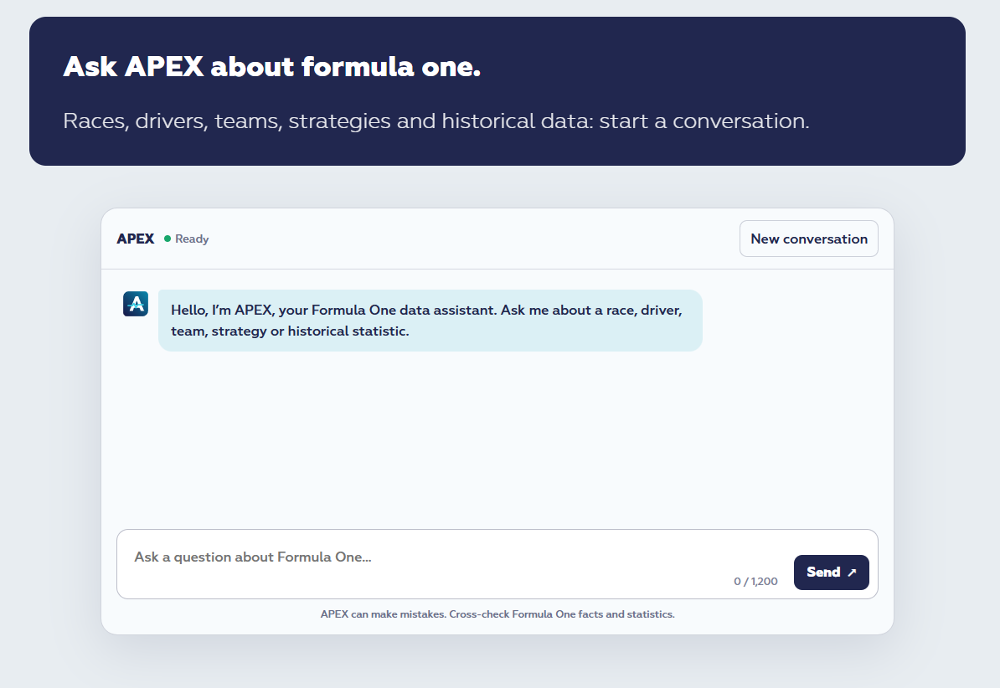

# APEX — RaceOptiData AI Agent

**Explore Formula 1 data through natural language.**

APEX is an AI-powered assistant developed as part of the RaceOptiData project. It allows users to explore more than 75 years of Formula 1 history by asking questions in natural language.

Instead of navigating database tables or writing SQL queries, users can interact with an AI agent capable of retrieving, analyzing and interpreting historical F1 data.

APEX combines generative AI with structured databases, semantic search and external information sources.

**APEX V1 is live and publicly accessible.**

🏎️ **[Try APEX on RaceOptiData](https://www.raceoptidata.com/APEX.html)**

The current version offers 10 free questions per user per day.

---

## 🎯 Project objectives

APEX was designed to demonstrate how generative AI can provide a conversational interface to an existing data platform.

Its main objectives are to:

* Make historical Formula 1 data accessible through natural language.
* Enable exploration of drivers, constructors, races, seasons and statistics.
* Combine structured data retrieval with contextual information.
* Use an AI agent to orchestrate specialized tools and data sources.
* Deploy a production-ready application with security, observability and cost-control mechanisms.

Beyond its Formula 1 use case, APEX illustrates an architecture that can be applied to enterprise data platforms and business information systems.

---

## 🏗️ Technical architecture

APEX is built on Microsoft Azure and integrates Microsoft Foundry, GPT-5-mini, Python and Azure SQL.

The architecture combines an AI agent with a set of specialized components responsible for data access, application integration, monitoring and operational control.

*APEX V1 — Technical Architecture*

### Main components

| Component                | Role                                                             |
| ------------------------ | ---------------------------------------------------------------- |
| Microsoft Foundry        | AI agent hosting and orchestration                               |
| GPT-5-mini               | Natural language understanding, reasoning and tool orchestration |
| Azure Functions          | Python-based application gateway and integration layer           |
| Azure SQL Database       | Structured Formula 1 data storage                                |
| Text-to-SQL              | Natural language access to relational data                       |
| RAG / Semantic Index     | Retrieval of contextual information from indexed documents       |
| Web Search               | Access to complementary external information                     |
| Azure Managed Identities | Secure authentication between Azure resources                    |
| Azure Table Storage      | Application telemetry and operational data                       |
| Cost monitoring          | Automated resource consumption monitoring and safeguards         |

---

## ⚙️ How APEX works

When a user submits a question, APEX processes it through an agent-based architecture.

1. **User interaction**
   The user submits a natural language question through the RaceOptiData web interface.

2. **Application gateway**
   An Azure Function receives the request and handles communication with the AI agent.

3. **Agent orchestration**
   The Microsoft Foundry agent interprets the question and determines which tools or information sources are required.

4. **Data retrieval**
   Depending on the request, the agent can access structured Formula 1 data through Text-to-SQL, retrieve contextual information through RAG or use Web Search.

5. **Response generation**
   The agent combines the retrieved information to generate a natural language response.

6. **Telemetry and monitoring**
   Application activity and resource consumption are monitored through dedicated observability and cost-control components.

This approach separates natural language reasoning from data access and application infrastructure.

---

## 🛡️ Production engineering

APEX is not limited to an LLM connected to a database.

Its architecture incorporates several mechanisms required to operate an AI application in a production environment.

### Security

* Azure Managed Identities for authentication between supported Azure resources.
* Controlled access to the underlying data platform.
* Separation between the conversational interface, agent orchestration and data access components.

### Observability

* Conversation and request tracking.
* Usage telemetry and operational events.
* Dedicated persistence for application monitoring.

### Cost management

* Automated monitoring of Azure resource consumption.
* Cost-control mechanisms for Azure SQL and Microsoft Foundry.
* Application-level safeguards to limit operational exposure.
* Daily usage quotas.

These components are essential to maintaining operational control over an AI application.

---

## 🧰 Technology stack

**AI & orchestration**

* Microsoft Foundry
* GPT-5-mini
* Function Calling
* Retrieval-Augmented Generation (RAG)
* Text-to-SQL

**Backend & integration**

* Python
* Azure Functions
* Azure SQL Database

**Security & operations**

* Azure Managed Identities
* Azure Table Storage
* Application telemetry
* Automated cost monitoring

**Frontend**

* HTML / JavaScript
* RaceOptiData web platform

---

## 🔗 Live application

APEX is available through RaceOptiData:

**[Launch APEX](https://www.raceoptidata.com/APEX.html)**

Discover the broader RaceOptiData ecosystem:

**[RaceOptiData](https://www.raceoptidata.com)**

---

## 📂 About this repository

This repository provides a technical overview of APEX V1, including its architecture and main engineering components.

**The application source code is not publicly distributed.**

The purpose of this repository is to document the project and illustrate the design and implementation of a production AI agent integrated with a real-world data platform.

---

## © Copyright

© 2026 — RaceOptiData / OPTIDATA IA

All rights reserved.
